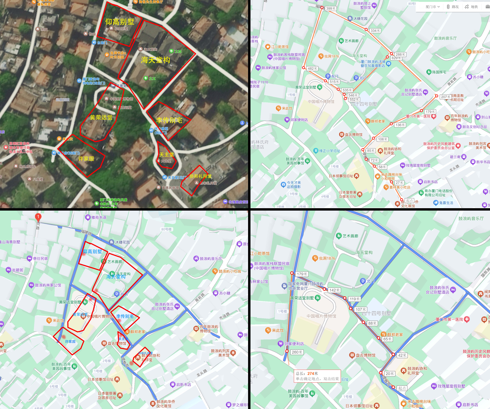
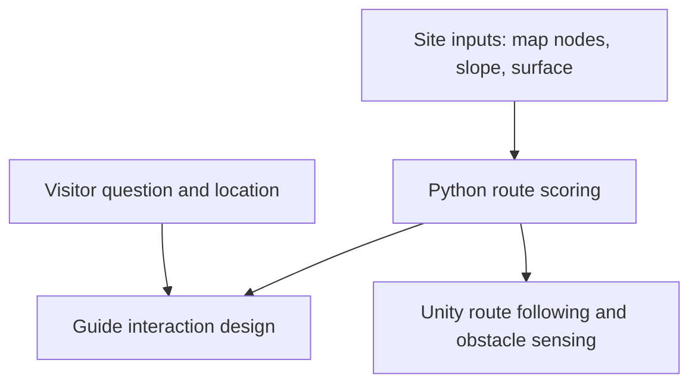
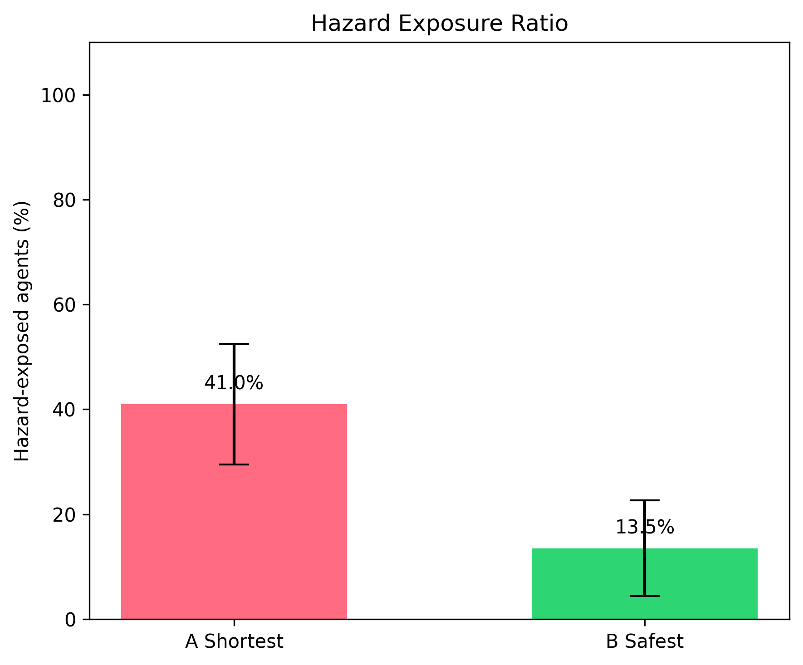

# Hearing Gulangyu | 听见鼓浪屿

**Accessible wayfinding prototype for Gulangyu, a historic island in Xiamen, China.**

Two routes can look similar on a map and feel very different on the ground. Hearing Gulangyu explores how slope, paving, and a visitor's mobility needs can inform both route choice and the guidance given along the way.

**My contribution:** I led the team project and developed the app prototype and backend routing service. I also built the Unity simulation used to compare route behavior.

[Site map](assets/figures/gulangyu_map.jpg) · [Guide design](docs/AI_PRODUCT_FLOW_DIAGRAM.md) · [Python routing sample](code_samples/backend/graph_engine.py) · [Unity sensing sample](code_samples/unity/DigitalCane.cs)

## From a map to a route

The routing prototype represents paths and building entrances as nodes and edges. Its Python sample uses NetworkX to compare paths and applies explicit weights for distance, slope, and modeled surface friction. Changing the profile changes how those factors are weighted.

The guide design uses the visitor's location and nearby heritage points to explain where to go. The route engine supplies the path options. [Voice and photo interaction notes](docs/VOICE_PHOTO_INTERACTION.md) show how a question can be matched to a place before the guide responds.

## How the team evaluated the prototype

In Unity, simulated agents followed routes and recorded modeled hazard events. The [route-following sample](code_samples/unity/RouteFollower.cs) shows how the scene handles waypoints; the digital-cane sample shows how ray casts detect tagged obstacles and trigger audio cues. The evaluation compared distance and completion time alongside simulated hazard exposure, so changes in modeled exposure could be read alongside changes in travel effort.

In ten paired Unity simulation runs, routes chosen with the safety-weighted profile recorded modeled hazard events at 13.5%, down from 41.0% on the shortest-path routes, while adding about 80 m and 41 s per route.

[Evaluation definitions](docs/ROUTING_AND_VALIDATION_METRICS.md) · [User needs and scenarios (Chinese)](docs/USER_RESEARCH_SUMMARY_CN.md)

This repository contains selected code excerpts and design notes for review. The full application, site database, and complete Unity scene are outside this release.

## 中文简介

“听见鼓浪屿”从一个具体问题开始：同样去一处老建筑，最短的路线是不是最适合这个人？我们把坡度、路面和不同出行需求放进路径模型，再在 Unity 中查看模拟路线的行进和障碍感知。我负责推进这个团队项目，开发导览原型和后端路径服务，并搭建了用于路线比较的 Unity 场景。
